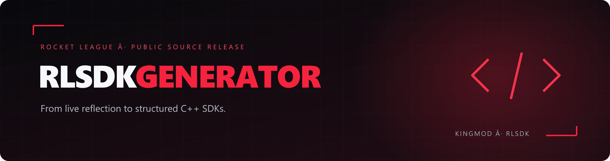
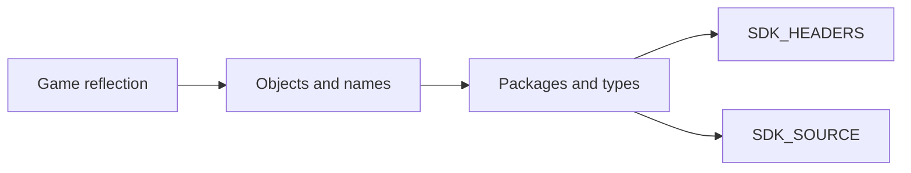

<div align="center">



**Inspect Unreal Engine 3 reflection. Generate structured C++ headers and source. Build on what you discover.**


[Build from source](#build-from-source) · [Configure](#configuration) · [Generated output](#generated-output) · [KingMod source](https://github.com/KingMod2008/KingModSourceCode) · [Issues](https://github.com/KingMod2008/RLSDKGenerator/issues)

</div>

> **This source release is freely available. You do not need to buy access to this repository.**  
> **Signed, rlsdk**

## From reflection to an SDK

RLSDKGenerator is a Windows DLL project for generating a Rocket League C++ SDK from the game's Unreal Engine 3 object and name data. It walks reflected packages, types, properties, and functions, then writes an organized SDK for inspection and development.

This repository publishes the generator source, its Visual Studio project, and documentation. Compiled DLLs, debug symbols, generated SDKs, and local Visual Studio settings are excluded from the source release.

## What is inside

| Capability | What it provides |
| :--- | :--- |
| **Package generation** | C++ output organized by reflected game package |
| **Type generation** | Enums, constants, structs, classes, and reflected members |
| **Function generation** | Parameter declarations and generated function wrappers |
| **Global discovery** | Configuration for pattern-based or offset-based object/name discovery |
| **Output formatting** | Enum style, alignment, spacing, game metadata, and output-path settings |
| **Optional diagnostics** | Name and object instance dumps, logging, and error notifications |
| **Cache regeneration** | A fast output-regeneration path controlled by a build flag |



## Build from source

### Requirements

- Windows x64.
- Visual Studio with **Desktop development with C++** and a Windows SDK.
- C++20 support.
- **MSVC v145** for the supplied Release x64 configuration; Debug targets **v143**.

No vcpkg installation or third-party package download is required by the checked-in project.

```powershell
git clone https://github.com/KingMod2008/RLSDKGenerator.git
cd RLSDKGenerator
```

Open `RLSDKGenerator.sln`, select **Release | x64**, and build the solution. Alternatively, use a Visual Studio developer terminal:

```powershell
msbuild RLSDKGenerator.sln /m /p:Configuration=Release /p:Platform=x64
```

The normal output is:

```text
x64/Release/RLSDKGenerator.dll
```

The supplied Release x64 configuration was built successfully for this source release. Runtime generation against your game build must still be validated separately.

## Configuration

Edit [`Engine/Rocket League/Configuration.cpp`](Engine/Rocket%20League/Configuration.cpp) before building.

| Setting | Purpose |
| :--- | :--- |
| `m_outputPath` | Base directory for generated files; currently `C:\SDK\` |
| `m_gameNameLong` / `m_gameNameShort` | Printed game name and output subfolder; currently Rocket League / RLSDK |
| `m_gameVersion` | Label written into generated output; update it for the game version you inspect |
| `m_useOffsets` | Select offsets or pattern discovery; currently `false` |
| `m_gobjectPattern` / `m_gobjectMask` | Object-array pattern and matching mask |
| `m_gnamePattern` / `m_gnameMask` | Name-array pattern and matching mask |
| `m_gobjectOffset` / `m_gnameOffset` | Global offsets when offset mode is selected |
| ProcessEvent / CallFunction settings | Select configured virtual indices or pattern settings |
| Enum and alignment settings | Control generated declarations and memory-layout formatting |

**Patterns, offsets, virtual indices, and layouts depend on the game build.** A successful compile does not prove those values match a newer version. The configured game-version string is a label, not automatic version detection. Choose an output location your process can write to.

### Build switches

The current switches are in [`pch.hpp`](pch.hpp):

| Switch | Current state | Effect |
| :--- | :--- | :--- |
| `NO_POPUPS` | Defined | Suppress popup notifications |
| `ULTRA_FAST_FILE_REGEN` | Defined | Enable the cache-based output-regeneration path |
| `SKIP_INSTANCE_DUMPS` | Defined | Skip automatic name/object dumps on attachment |
| `NO_LOGGING` | Commented out | Logging is not disabled by this switch |

If you enable instance dumps, review the resulting files before sharing them. Generated addresses and runtime data should not be treated as release source files.

## Generation lifecycle

The project builds a DLL, not a standalone application or launcher. When the DLL is loaded into a compatible game process, its entry point starts a worker thread, calls `Generator::GenerateSDK()`, optionally dumps instances, then calls `FreeLibraryAndExitThread()`.

The repository does not include a loader or kernel driver. Validate your configuration and use an appropriate development environment. This project is independent of Psyonix and Epic Games; game rules and technical restrictions still apply.

## Generated output

With the current path and short-name defaults, the base SDK folder is `C:\SDK\RLSDK\`:

```text
C:\SDK\RLSDK\
├── SDK_HEADERS/
│   ├── SdkHeaders.hpp
│   ├── GameDefines.hpp
│   └── <package>/...
└── SDK_SOURCE/
    ├── GameDefines.cpp
    └── <package>/...
```

Additional files depend on configuration. For example, constants and instance dumps have their own settings. Keep the generated headers and source together when integrating the SDK into another project.

## Source map

```text
Engine/
├── Engine.cpp / Engine.hpp       Generator identity and engine helpers
└── Rocket League/
    ├── Configuration.*          Discovery, formatting, game and output settings
    ├── GameDefines.*            Reflected engine type definitions
    └── PiecesOfCode.*           Templates used in generated output
Framework/
├── Member.*                     Member and property metadata
└── Printer.*                    C++ formatting and file output helpers
dllmain.cpp / dllmain.hpp        Generation pipeline and DLL lifecycle
pch.cpp / pch.hpp                Shared includes and build switches
assets/                         README artwork
```

## Troubleshooting

| Problem | Check |
| :--- | :--- |
| Toolset cannot be found | Install v145 for Release x64, or retarget the project to an installed compatible toolset |
| Output cannot be created | Verify `m_outputPath`, its parent directory, and write permissions |
| Globals cannot be initialized | Check object/name patterns or offsets against the exact game build |
| Generated layouts are incorrect | Recheck game definitions, alignment, virtual indices, and configuration |
| No instance dump appears | `SKIP_INSTANCE_DUMPS` is defined by default |

## Credits & license

This source tree is distributed under its existing **[MIT License](LICENSE)**, copyright **CodeRedModding (2025)**. Preserve the copyright and license notices when redistributing it.

This public release is maintained under **KingMod2008**, with generator credits identifying **rlsdk (KingMod)**. Upstream engine references remain credited in the source.

---

<div align="center">

**Inspect. Generate. Learn.**  
**Signed, rlsdk**  
[KingMod source](https://github.com/KingMod2008/KingModSourceCode) · [Back to top ↑](#)

</div>
